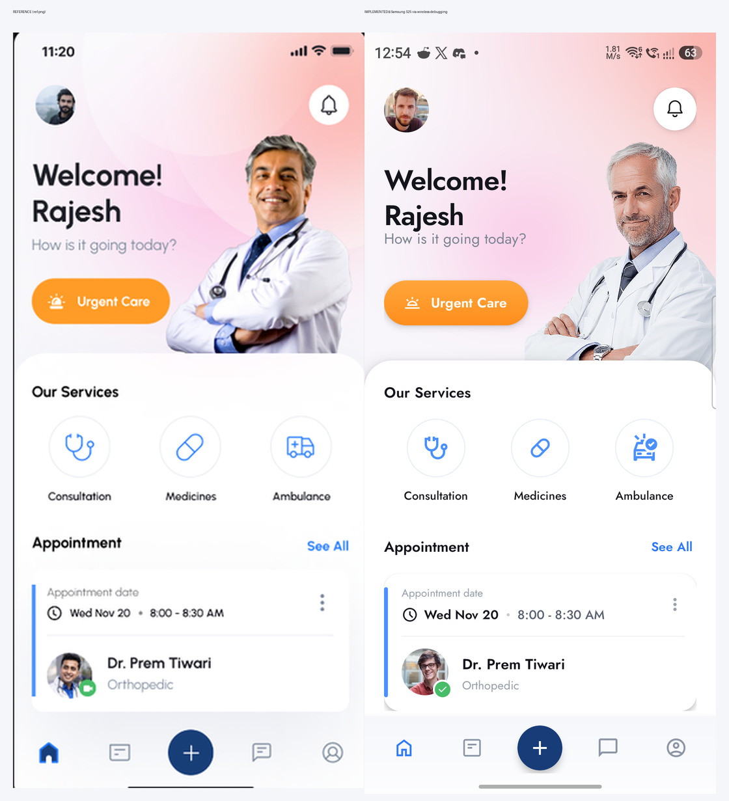

# Mimicking `ref.png` — implementation guide

This project now implements the reference healthcare home screen (welcome header, services,
appointment card and custom bottom navigation) as the launcher activity, and it was verified on a
physical phone over **wireless debugging**.



## Where everything lives

| Concern | File |
| --- | --- |
| Whole screen layout | [`app/src/main/res/layout/activity_main.xml`](app/src/main/res/layout/activity_main.xml) |
| Insets, click handling, bottom-nav selection | [`app/src/main/java/com/example/sprint1/MainActivity.java`](app/src/main/java/com/example/sprint1/MainActivity.java) |
| Typography styles | [`app/src/main/res/values/styles.xml`](app/src/main/res/values/styles.xml) |
| Palette | [`app/src/main/res/values/colors.xml`](app/src/main/res/values/colors.xml) |
| Theme / system bars | [`app/src/main/res/values/themes.xml`](app/src/main/res/values/themes.xml) |
| Font (Jost, 4 weights) | `app/src/main/res/font/jost_*.ttf` |
| Header gradient | [`app/src/main/res/drawable-xxhdpi/bg_header_photo.jpg`](app/src/main/res/drawable-xxhdpi/bg_header_photo.jpg) |
| Doctor cutout + avatars | `app/src/main/res/drawable-nodpi/` |
| Vector icons | `app/src/main/res/drawable/ic_*.xml` |

## Screen anatomy

1. **Root** — vertical `LinearLayout`; the `NestedScrollView` takes `layout_weight="1"`, the bottom
   navigation is a fixed sibling. That keeps the bar pinned while the content scrolls.
2. **Header** — a `FrameLayout` (`364dp`) with a generated gradient bitmap. The transparent doctor
   PNG is anchored `bottom|end` and gets partially covered by the white surface below. A
   `ConstraintLayout` (`header_content`) holds avatar, bell, greeting and the orange CTA; its top
   padding is the status-bar inset + `18dp`, applied at runtime.
3. **White surface** — one `MaterialCardView` with *top-only* rounded corners
   (`ShapeAppearanceOverlay.Sprint1.HeaderCard`) and `layout_marginTop="-28dp"`. The negative margin
   makes it overlap the header exactly like the reference. It contains both the services and
   appointment sections so there is no visible seam between them.
4. **Our Services** — three `layout_weight="1"` columns. Each is a `60dp` circle
   (`bg_service_circle`, 1dp border) with a `28–31dp` tinted vector icon, plus a caption.
5. **Appointment** — a `MaterialCardView` (`16dp` radius) containing a `ConstraintLayout`: a `4dp`
   blue bar with 14dp top/bottom margins, then a vertical content column (date label → time row →
   divider → doctor row). The green verified badge is a `20dp` layer-list oval with a white ring.
6. **Bottom navigation** — five equal-weight slots in a `LinearLayout`; the middle is a `46dp` navy
   `MaterialCardView` FAB. Tinting is switched in code when another slot is selected.

## Design tokens taken from the reference

| Token | Value |
| --- | --- |
| Blue (links/active) | `#2F7BF6` |
| Icon blue | `#4A90FF` |
| Navy FAB | `#173C78` |
| Orange CTA | `#FF9C27` → `#FF8E1C` |
| Green badge | `#48BD69` |
| Primary text | `#14151C` |
| Secondary text | `#7C8492` |
| Muted text | `#98A0AC` |
| Header base / pink / peach | `#F8F7FB` / `#FBD2EB` / `#FBBBB6` |

Typography is **Jost** (SIL OFL), which matches the reference's condensed geometric letterforms much
better than the default Roboto or a wide geometric such as Poppins:

| Role | Size / weight |
| --- | --- |
| “Welcome!” / “Rajesh” | 29sp, 600, line-height 36dp |
| Subtitle | 15sp, 400 |
| Section titles | 15sp, 600, line-height 21dp |
| CTA | 14sp, 600 |
| Service captions | 12sp, 500 |
| Time / “See All” | 13sp |
| Doctor name | 15sp, 600 |
| Date label | 11sp, 400 |

## Techniques and gotchas worth remembering

- **Edge-to-edge:** `EdgeToEdge.enable(this)`, transparent bars, dark icons via
  `WindowInsetsControllerCompat`. Apply `bars.top + 18dp` to the header content and
  `bars.bottom + 6dp` to the bottom bar. The gradient still paints under the status bar because the
  padding is on the inner content, not the background view.
- **MaterialCardView adds content padding by default.** It showed up as an unexpected 8dp inset on
  every edge. Set `app:cardUseCompatPadding="false"` and
  `app:cardPreventCornerOverlap="false"` when you need exact alignment.
- **Top-only rounded corners:** use a `shapeAppearanceOverlay` with
  `cornerSizeTopLeft/TopRight = 28dp` and `cornerSizeBottom* = 0dp`.
- **Doctor cutout:** a transparent PNG in `drawable-nodpi`, fixed `196dp × 252dp`, `centerCrop`,
  anchored bottom-right. The white card sits on top of its lower edge.
- **Font leading is not automatic.** With `includeFontPadding="false"` you still need
  `lineHeight` and small negative/positive margins to reproduce the tight reference spacing.
  The subtitle uses `layout_marginTop="-8dp"`.
- **Material Symbols vectors** use a `0 -960 960 960` viewBox. Wrap their path in
  `<group android:translateY="960">` to render correctly in a VectorDrawable.
- **Snackbar anchoring:** `setAnchorView(binding.bottomNav)` keeps feedback above the custom bar.
- **Debug keystore:** `~/.android` is read-only in this environment, so
  [`app/build.gradle.kts`](app/build.gradle.kts) points the debug build at the project-local
  [`app/debug.keystore`](app/debug.keystore). Keep that key if you want `adb install -r` to keep
  working; it is git-ignored.

## Build, install and mirror to the phone

```bash
./gradlew :app:assembleDebug
adb install -r app/build/outputs/apk/debug/app-debug.apk
adb shell am start -n com.example.sprint1/.MainActivity
adb exec-out screencap -p > screenshots/home_screen.png
```

If Gradle cannot write `~/.gradle` (sandboxed shell), point it at a writable cache:

```bash
export GRADLE_USER_HOME=/tmp/dsh-gradle-home
```

## Wireless debugging (what was used)

1. Phone and PC on the same Wi‑Fi.
2. On the phone: **Settings → About phone → tap Build number ×7**, then
   **Developer options → Wireless debugging → On**.
3. Tap **Pair device with pairing code** and read the `IP:port` and 6-digit code.
4. From the PC:

   ```bash
   adb pair 192.168.1.217:38391 190975     # pairing port + one-time code
   adb connect 192.168.1.217:38491         # "IP address & port" on the Wireless debugging screen
   adb devices -l
   ```

5. Install, launch and capture:

   ```bash
   adb install -r app/build/outputs/apk/debug/app-debug.apk
   adb shell am start -W -n com.example.sprint1/.MainActivity
   adb exec-out screencap -p > screenshots/home_screen.png
   ```

The pairing port/code are regenerated by the phone each time. `adb mdns services` can discover the
connect endpoint when mDNS works; the USB fallback is `adb tcpip 5555` followed by
`adb connect <phone-ip>:5555`.

> In this sandbox the adb server does not survive between shell invocations, so pairing/connecting,
> installing and screenshotting were done in a single command. Do the same if `adb devices` looks
> empty right after a successful connect.

## How the layout was tuned

The screen was measured with the real device rather than guessed:

```bash
adb shell uiautomator dump /sdcard/window.xml
adb pull /sdcard/window.xml
# bounds are in pixels; divide by 3 for dp on this 480dpi device
```

That exposed the `cardUseCompatPadding` inset and let the header, services and appointment blocks be
aligned to the reference within a few dp. The final device screenshot is
[`screenshots/home_screen.png`](screenshots/home_screen.png) and the reference/app comparison is
[`screenshots/reference_vs_app.png`](screenshots/reference_vs_app.png).

## Placeholder assets — replace before shipping

- Doctor cutout: `pngimg.com` (check the license for commercial use).
- Avatars: `randomuser.me` (test portraits).
- Icons: Google **Material Symbols** (Apache 2.0).
- Font: **Jost**, SIL OFL 1.1.
